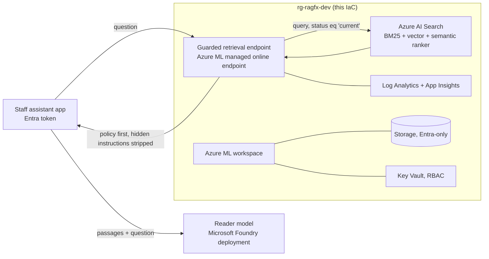

# Deployment to Azure AI Search and Microsoft Foundry / Azure ML (written, not run)

Nothing here has been deployed. The IaC is checked in CI (`terraform validate` and `test` with mocked
providers, `tflint`, `checkov`, `bicep build`), and the deploy workflow is switched off.

## Target design

The endpoint returns guarded passages. The reader model is **not** created here: pick one in the
Foundry catalog, deploy it, and give the app its endpoint. Re-run this repo's eval against the cloud
pipeline before switching any traffic (see the implementation guide).

| Resource | Terraform | Bicep |
|---|---|---|
| Log Analytics + Application Insights | `azurerm_*` | same ARM types |
| Storage (TLS 1.2, no shared keys, no public blobs) | `azurerm_storage_account` | `Microsoft.Storage/storageAccounts` |
| Key Vault (RBAC, purge protection) | `azurerm_key_vault` | `Microsoft.KeyVault/vaults` |
| Azure AI Search, Basic, API keys disabled, semantic ranker free plan | `azurerm_search_service` | `searchServices@2025-05-01` |
| Endpoint identity -> Search Index Data Reader (read only) | `azurerm_role_assignment` | `roleAssignments` |
| Azure ML workspace (identity access to storage) | `azapi_resource` (2025-06-01) | `workspaces@2025-06-01` |
| Managed online endpoint (`AADToken`) | `azapi_resource` | `onlineEndpoints@2025-06-01` |
| Diagnostic settings (workspace, Key Vault, Search) | `azurerm_monitor_diagnostic_setting` | `diagnosticSettings` |

- `scripts/index_azure_search.py` creates the index (`ragfail/azure_search.py`: HNSW cosine vectors
  of the same 384-dimension embeddings the local eval used, a semantic configuration, and the
  `status`/`doc_type` fields the guards filter on) and uploads the chunks with Entra ID.
- `infra/aml/score.py` queries Azure AI Search when `SEARCH_ENDPOINT` is set, otherwise the local
  BM25 index, and is unit-tested offline (`tests/test_azure_service.py`).

## Cost before anyone says yes

Prices from the Azure Retail Prices API, pay-as-you-go, eastus2, checked 2026-11-09:

| Item | Price | 730-hour month |
|---|---|---|
| Endpoint VM, Standard_DS2_v2 Linux, 1 instance | $0.114 per hour | about $83 |
| Azure AI Search, Basic, 1 replica, 1 partition | $0.101 per hour | about $74 |
| Semantic ranker | free plan (limited monthly queries) | $0 |

About **$157 per month** always-on, plus small Log Analytics, storage and Key Vault charges. Prod with
two search replicas adds about $74. The Foundry reader deployment is billed separately and is not in
this IaC. Delete the resource group to stop charges. Check current prices and get approval before
enabling the workflow.

## One-time setup (only if approved)

1. Entra app registration with a federated credential for this repo's `dev` environment.
2. Contributor and Search Index Data Contributor on one resource group.
3. Repository variables `AZURE_CLIENT_ID`, `AZURE_TENANT_ID`, `AZURE_SUBSCRIPTION_ID`.
4. A required reviewer on the `dev` environment.
5. `DEPLOY_ENABLED=true`, then run **deploy** by hand.

## Planned, not built

Private endpoints and a VNet, a prod stage, a teardown workflow, query-time vectors in the endpoint
(today the cloud path uses keyword + semantic ranker only), and the cloud eval run.
